# DMA (Direct Memory Access) 정리

---

## 📚 참고 문서

| 약어 | 문서 | 파일명 |
|---|---|---|
| **RM** | RM0390 Rev 9 — STM32F446xx Reference Manual (1321쪽) | `rm0390-stm32f446xx-advanced-armbased-32bit-mcus-stmicroelectronics.pdf` |
| **DS** | DS10693 Rev 11 — STM32F446xC/E Datasheet (197쪽) | `stm32f446mc.pdf` |
| **UM** | UM1724 Rev 17 — STM32 Nucleo-64 boards (MB1136) User Manual (91쪽) | `dm00105823-stm32-nucleo-64-boards-mb1136-stmicroelectronics.pdf` |


---

# DMA의 개념

## 1. 정의

**DMA(Direct Memory Access)는 CPU를 거치지 않고 메모리↔주변장치, 또는 메모리↔메모리 사이에서 데이터를 옮기는 전용 하드웨어**입니다.

CPU는 "어디서, 어디로, 몇 개를, 어떤 방식으로" 옮길지만 설정합니다. 실제 이동은 DMA가 백그라운드에서 처리하고, CPU는 **데이터 블록 전체가 준비되었을 때만** 인터럽트를 받습니다. 

DMA의 또 다른 장점은 구조에 있습니다. 주변장치마다 전용 버퍼 메모리를 따로 두는 분산 방식 대신, **시스템 SRAM에 데이터를 모으는 중앙 집중 방식**을 쓸 수 있습니다. 그래서 **실리콘 면적과 소비 전력 면에서 유리합니다.** 

## 2. 데이터 전송 방식 비교

UART로 1000바이트를 보내는 경우로 비교합니다.

### ① 폴링 (Polling)
```c
for (int i = 0; i < 1000; i++) {
    while (!(USART2->SR & USART_SR_TXE));  // 송신 버퍼가 빌 때까지 대기
    USART2->DR = buf[i];
}
```
- CPU가 상태 비트를 계속 확인하며 기다립니다.
- 115200bps에서는 1바이트에 약 87µs가 걸리므로, 1000바이트면 **약 87ms 동안 CPU가 다른 일을 하지 못합니다.**

### ② 인터럽트 (Interrupt)
- TXE 인터럽트가 걸릴 때마다 ISR에서 1바이트를 씁니다.
- 기다리는 동안 CPU는 다른 일을 할 수 있습니다. 하지만 **바이트마다 인터럽트가 걸리므로 1000번** 발생하고, 매번 컨텍스트 저장/복원 오버헤드가 생깁니다.
- 고속 주변장치(수십 Mbps SPI, MSPS급 ADC)에서는 처리가 늦어 오버런이 날 수 있습니다.

### ③ DMA
- CPU는 시작할 때 한 번 설정하고, 끝났을 때 인터럽트를 1~2회(절반/완료)만 받습니다.

| 방식 | CPU 점유 | 인터럽트 횟수 | 고속 데이터 대응 |
|---|---|---|---|
| 폴링 | 매우 높음 | 0 | CPU를 독점함 |
| 인터럽트 | 중간 | 데이터 개수만큼 | 한계 있음 |
| DMA | 매우 낮음 | 1~2회 | 우수 |

## 3. DMA의 동작 원리

### 3-1. 버스 마스터

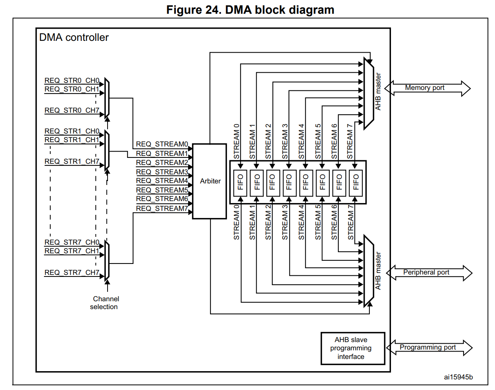

- **AHB 마스터**는 읽기/쓰기를 시작할 수 있는 주체입니다. **AHB 슬레이브**는 마스터의 요청에 응답하는 쪽입니다. 
- DMA는 **CPU와 같은 급의 버스 마스터**입니다. 그래서 버스 매트릭스를 통해 직접 메모리와 주변장치에 접근합니다. + 같은 급이 아니면 cpu를 거쳐야해요. 설정은 cpu가 일은 얘가.
- STM32F4의 DMA는 **AHB 포트 3개**를 가집니다. 설정용 **슬레이브 포트** 1개와, 전송용 **마스터 포트** 2개(Memory port, Peripheral port)입니다.


```
   ┌───────────┐   ┌──────┐  ┌──────┐
   │ Cortex-M4 │   │ DMA1 │  │ DMA2 │      ← 마스터
   └─────┬─────┘   └──┬───┘  └──┬───┘
 ════════╪════════════╪═════════╪═══════   멀티레이어 AHB 버스 매트릭스
         │        │        │        │
      Flash     SRAM1    SRAM2   AHB/APB 주변장치   ← 슬레이브
```


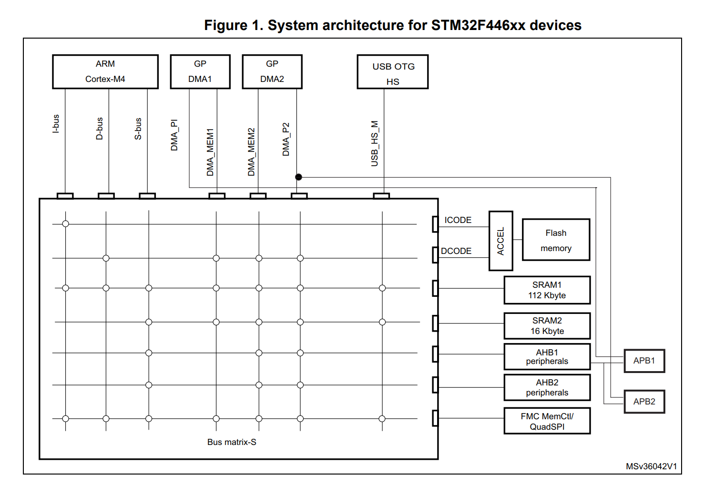


### 3-2. 한 번의 전송 과정

#### (1) DMA 전송을 이루는 3가지 동작
DMA 전송 1회는 다음 3가지 동작으로 이루어집니다.
1. **읽기**: 주변장치 데이터 레지스터나 메모리에서 읽습니다 (`SxPAR` 또는 `SxM0AR`가 가리키는 곳).
2. **쓰기**: 읽은 데이터를 주변장치 데이터 레지스터나 메모리에 씁니다 (`SxPAR` 또는 `SxM0AR`가 가리키는 곳).
3. **NDTR 감소**: 남은 전송 개수를 1 줄입니다.

각 전송에는 Peripheral port 1회, Memory port 1회, 이렇게 **두 번의 버스 접근**이 필요합니다. 

#### (2) Request / Acknowledge 핸드셰이크 
DMA와 **주변장치 사이**에서는 다음 순서로 신호를 주고받습니다.

1. 이벤트가 발생하면(예: UART RXNE, TXE) 주변장치가 DMA에 **Request**를 보냅니다.
2. DMA가 우선순위에 따라 요청을 처리합니다.  **주변장치에 접근하는 순간** 주변장치에 **Acknowledge**를 보냅니다.
3. 주변장치는 Acknowledge를 받으면 **Request를 내립니다.**
4. Request가 내려가면 DMA가 **Acknowledge를 내립니다.**
5. 요청이 더 있으면 주변장치가 다음 전송을 시작합니다.

```
                    ①      ②        ③        ④
 주변장치 Request  __/‾‾‾‾‾‾‾‾‾‾‾\_______________
 DMA Acknowledge   ________/‾‾‾‾‾‾‾‾‾‾‾\_________
                  요청   접근+ACK  요청 해제  ACK 해제 → 다음 요청 가능
```
(위 그림은 RM p.203의 문장을 순서대로 그린 설명용 그림입니다.)

> 핸드셰이크는 **DMA ↔ 주변장치 사이**에서만 일어납니다. **메모리 쪽**에는 핸드셰이크가 없고, FIFO 임계값(Direct 모드에서는 즉시)이 메모리 접근의 시작 신호가 됩니다. 

#### (3) 전송 방향별 순서: 주변장치 쪽과 메모리 쪽은 FIFO로 분리되어 있음

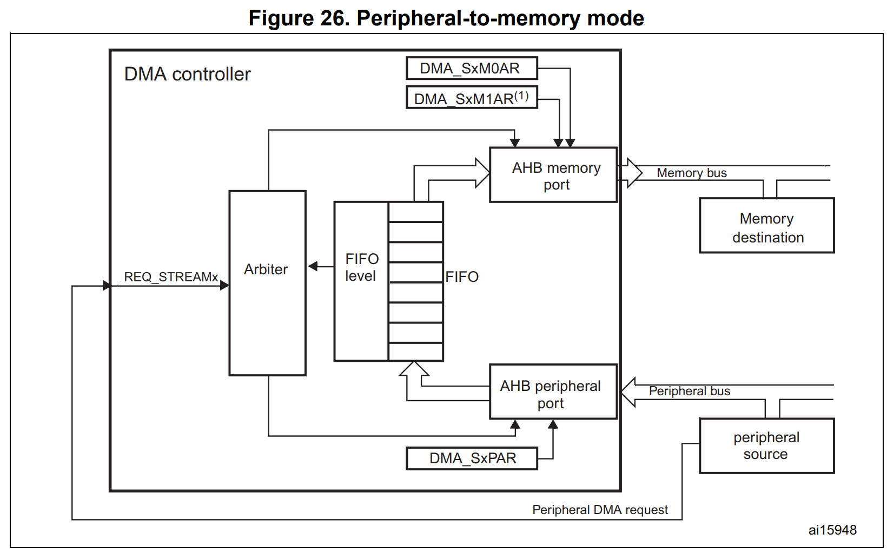

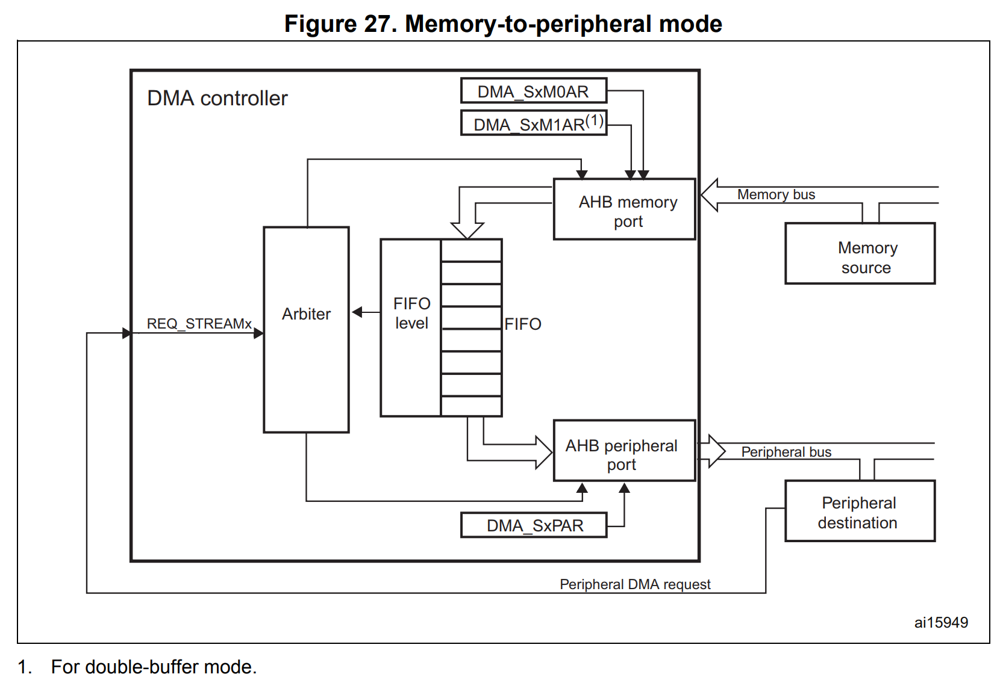


DMA는 **AHB memory port**와 **AHB peripheral port**를 따로 가지고 있습니다.  각 포트는 **중재(arbitration)에서 이겨야** 소스나 목적지에 접근할 수 있고, 두 포트 사이에 **FIFO**가 있습니다.  그래서 주변장치 쪽 전송과 메모리 쪽 전송은 **서로 다른 시점**에 일어납니다.

```
P→M:  [주변장치 Request] → 중재 → 주변장치 읽기(+ACK) → FIFO ─(임계값/즉시)→ 중재 → 메모리 쓰기
M→P:  [EN=1] → 중재 → 메모리 읽기 → FIFO ─(주변장치 Request)→ 중재 → 주변장치 쓰기(+ACK)
                  ↑ M→P는 요청이 오기 "전에" 메모리를 미리 읽어 둠
```

| 단계 | Peripheral → Memory | Memory → Peripheral |
|---|---|---|
| ① | CPU가 설정한 뒤 **EN=1** | CPU가 설정한 뒤 **EN=1** → 즉시 **메모리에서 읽어 FIFO를 채움** (FIFO 모드는 가득, Direct 모드는 1개 preload) |
| ② | 주변장치 **Request** (예: RXNE) | 주변장치 **Request** (예: TXE) |
| ③ | 중재 → **주변장치에서 읽어 FIFO에 저장** (+ACK) | 중재 → **FIFO에서 꺼내 주변장치에 씀** (+ACK) |
| ④ | FIFO **임계값 도달** 시(Direct 모드는 즉시) → 중재 → **메모리에 씀** | FIFO가 **임계값 이하**가 되면(Direct 모드는 즉시) → 중재 → **메모리에서 다시 채움** |
| ⑤ | NDTR 감소. 설정에 따라 주소 증가. 0이 되면 **TC** | NDTR 감소. 설정에 따라 주소 증가. 0이 되면 **TC** |  

  

> 💡 M→P에서 DMA는 요청이 오기 전에 데이터를 **미리 읽어 둡니다(preload).**  그런데 메모리 버스를 얻기 **전에** 주변장치 요청이 먼저 오면 **언더런**이 생기고 **FEIF**가 설정될 수 있습니다. 
>
> 💡 P→M에서는 데이터가 FIFO에 머물다가 임계값에 도달해야 메모리에 쓰입니다. 스트림을 끄면 FIFO에 남은 데이터가 flush된 뒤 TC가 뜹니다. 〔RM p.216〕

### 3-3. DMA 주요 기능 (DMA main features) 

| 기능 | 내용 
|---|---|
| 버스 구조 | **Dual AHB master bus**: 마스터 하나는 메모리 접근 전용, 하나는 주변장치 접근 전용 |
| 설정 인터페이스 | AHB slave programming interface. **32bit 접근만** 지원 | 
| Stream / Channel | 컨트롤러당 **8 stream**, stream당 최대 **8 channel(요청)**. 채널은 소프트웨어로 선택하며, 여러 주변장치가 DMA 요청을 낼 수 있음 | 
| FIFO | stream마다 **4-word FIFO**. FIFO 모드와 Direct 모드 중 선택 | 
| └ FIFO 모드 | 임계값을 소프트웨어로 선택 (※ 9.2에는 1/4, 1/2, 3/4만 적혀 있지만 §9.3.13 p.213, Table 34 p.215에는 **Full까지 4단계**) |
| └ Direct 모드 | DMA 요청마다 즉시 메모리와 전송. M→P에서는 메모리 데이터 **1개만** FIFO에 미리 읽어 둠(preload) | 
| 전송 종류 | **regular channel**: P→M, M→P, M→M / **double buffer channel**: 메모리 쪽 더블 버퍼 |
| 우선순위 | 소프트웨어 4단계 (very high, high, medium, low). 같으면 하드웨어 (request 0 > request 1) | 
| M2M 소프트웨어 트리거 | stream마다 지원하지만 **DMA2에서만** 가능 | 
| 흐름 제어 | **DMA flow controller**: 개수를 소프트웨어로 1 ~ 65535 설정 / **Peripheral flow controller**: 개수를 모를 때 주변장치가 하드웨어로 끝을 알림 | 
| 데이터 폭 | 소스와 목적지 폭(byte, half-word, word)을 **독립 설정**. 폭이 다르면 자동 패킹/언패킹. **FIFO 모드에서만** 가능 | 
| 주소 증가 | 소스와 목적지 각각 증가 / 고정 | 
| 버스트 | **4, 8, 16 beat** 증가 버스트. 크기는 소프트웨어로 설정하며, 보통 주변장치 FIFO의 절반 | 
| Circular | stream마다 circular buffer 관리 지원 | 
| 이벤트 플래그 | **5개** (HT, TC, TE, FE, DME)가 OR되어 **stream당 인터럽트 요청 1개** |   

## 4. 전송 방향

| 방향 | 사용 예 |
|---|---|
| **Peripheral → Memory** | ADC 결과 저장, UART/SPI 수신 |
| **Memory → Peripheral** | UART/SPI 송신, DAC 파형 출력 |
| **Memory → Memory** | 큰 배열 복사. 주변장치 요청 없이 Enable하는 즉시 시작합니다. **F446에서는 DMA2만 가능합니다.** |

## 5. 전송 모드

### Normal
NDTR이 0이 되면 스트림이 정지합니다(EN이 하드웨어에 의해 0이 됨). 다시 하려면 재설정해야 합니다. 

### Circular
NDTR이 0이 되면 처음 값으로 **자동 재로드**되고 계속 반복합니다. ADC 연속 변환, UART 링 버퍼, DAC 파형 반복 출력에 씁니다. 

### Half-transfer를 이용한 핑퐁 처리
절반 지점에서 발생하는 HT 인터럽트와 끝에서 발생하는 TC 인터럽트를 이용합니다. 

```
 버퍼: [ 앞 절반 | 뒤 절반 ]
 HT 인터럽트 → CPU는 앞 절반을 처리 (DMA는 뒤 절반을 채우는 중)
 TC 인터럽트 → CPU는 뒤 절반을 처리 (DMA는 다시 앞 절반을 채우는 중)
```

### Double-buffer
서로 떨어진 두 버퍼(M0AR, M1AR)를 하드웨어가 자동으로 번갈아 사용합니다. 자세한 내용은 아래의 #9-double-buffer-모드

## 6. 버스 점유 방식

### F446RE: 멀티레이어 AHB 버스 매트릭스 〔RM p.53〕
- 32bit 멀티레이어 AHB 버스 매트릭스가 **마스터 7개**와 **슬레이브 7개**를 연결합니다.
  - 마스터: Cortex-M4 I-bus, D-bus, S-bus / **DMA1 memory bus** / **DMA2 memory bus** / **DMA2 peripheral bus** / USB OTG HS DMA bus
- 버스 매트릭스는 마스터와 슬레이브를 연결해 **동시 접근(concurrent access)**을 가능하게 합니다.
  - **서로 다른 슬레이브**에 접근하면 **동시에** 전송됩니다. 예를 들어 CPU가 Flash에서 명령어를 가져오는 동안 DMA는 SRAM1에 쓸 수 있고, 이때 CPU는 기다리지 않습니다.
  - 따라서 "DMA가 버스를 쓰면 CPU가 기다린다"는 상황은 **같은 슬레이브를 두고 경쟁할 때만** 생깁니다.


> 💡 마스터 목록에 **DMA1 peripheral bus가 없습니다.** DMA1의 Peripheral port는 버스 매트릭스에 연결되지 않고 APB1으로 바로 이어집니다. 그래서 **DMA1은 메모리 간 전송(M2M)을 할 수 없습니다.** 
> DMA peripheral bus는 "AHB 주변장치 접근과 메모리 간 전송에 쓰인다"고 설명되어 있는데, 이는 DMA2의 peripheral bus를 가리킵니다. 

### 같은 슬레이브를 두고 경쟁할 때: 라운드 로빈 
- "The BusMatrix manages the access arbitration between masters. The arbitration uses a **round-robin** algorithm."
- 여러 마스터가 같은 슬레이브(예: SRAM1)에 동시에 접근하면, 매트릭스가 마스터들에게 **차례대로** 접근 권한을 줍니다.

### 고전적인 분류와 비교

| 고전 분류 | F446에서 대응하는 것 | 
|---|---|
| 버스트(블록) 모드 | **DMA 버스트 전송(INCR4/8/16)**. 버스트 도중에는 AHB가 잠겨서 중재기가 DMA로부터 버스를 빼앗지 않습니다. 단, 블록 **전체**가 아니라 **최대 16 beat**까지만 해당합니다. | 
| 사이클 스틸링 | **Single 전송**. 요청 1개당 데이터 1개를 옮기고, 같은 슬레이브라면 매번 라운드 로빈 중재를 거칩니다. 〔추론〕 이 방식에 가장 가깝습니다. |
| 투명 모드 | **해당 기능 없음** | 

## 7. 일반적인 주의사항

1. **데이터 일관성**: DMA가 쓰는 중인 영역을 CPU가 읽지 않도록 HT/TC 인터럽트로 동기화합니다. 
2. **`volatile`**: DMA가 바꾸는 변수를 폴링으로 확인한다면 `volatile`이 필요할 수 있습니다. 
3. **버퍼 수명**: 지역 변수(스택)를 DMA 버퍼로 쓰지 마세요. 전역 또는 `static`으로 선언합니다. 
4. **정렬**: 16/32bit 전송에서는 주소가 2/4바이트 정렬되어야 합니다. 〔RM p.206〕
---

# STM32F446RE의 DMA

## 1. 전체 구성


| 항목 | 내용 |
|---|---|
| 컨트롤러 | **DMA1, DMA2** (dual-port DMA) |
| 스트림 | 컨트롤러당 **8개** (Stream 0~7), 총 16개 |
| 채널 | 스트림당 **8개 요청 중 1개 선택** (CHSEL) |
| FIFO | 스트림당 **4 word(16바이트)**, FIFO 모드 또는 Direct 모드 |
| 데이터 폭 | byte / half-word / word, 소스와 목적지를 독립적으로 설정 (FIFO 모드일 때) |
| 전송 개수 | **1 ~ 65535** (NDTR 16bit) |
| 버스트 | Single, INCR4, INCR8, INCR16 (FIFO 모드에서만) |
| 모드 | Normal, Circular, Double-buffer |
| 우선순위 | 소프트웨어 4단계 + 하드웨어 (스트림 번호) |
| 인터럽트 | HT, TC, TE, FE, DME — 스트림마다 하나의 인터럽트 벡터로 OR됨 |
| 레지스터 접근 | **32bit(word) 단위만** 가능 〔RM p.222〕 |
| 클럭 | `RCC_AHB1ENR` bit 21 **DMA1EN**, bit 22 **DMA2EN** 〔RM p.142–143〕 |


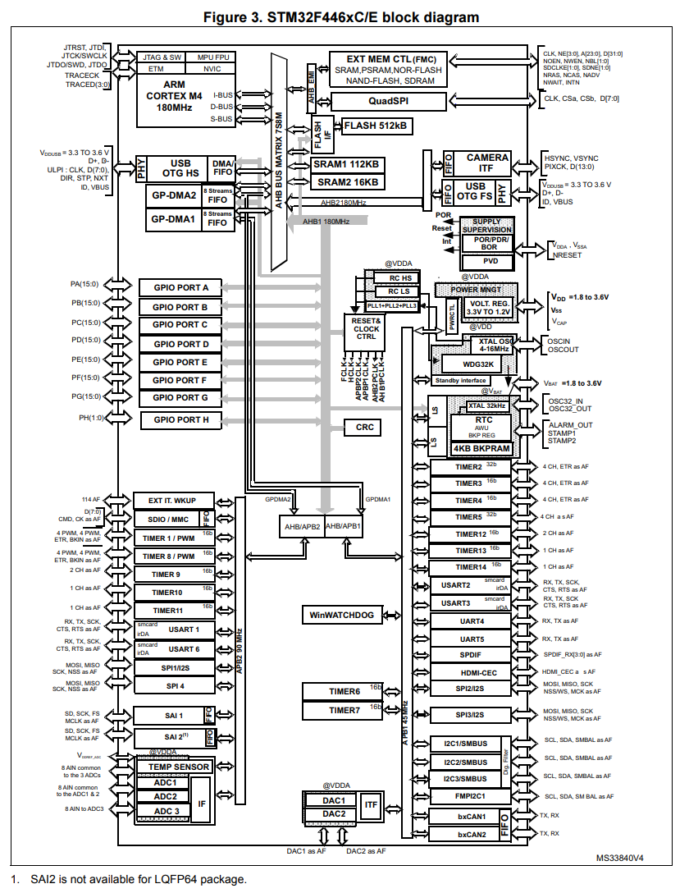

## 2. Stream과 Channel

STM32F4 DMA에서 가장 헷갈리는 용어입니다. (참고: F1, L4 같은 다른 STM32 계열에서는 "channel"이 실제 전송 통로를 뜻해서 의미가 다릅니다. 이 내용은 4개 PDF에 나오지 않습니다.)

- **Stream**: 실제로 전송을 수행하는 **독립된 단방향 통로**입니다. 스트림마다 주소, 개수, 설정, FIFO가 따로 있습니다. 
- **Channel**: 그 스트림에 **어느 주변장치의 요청을 연결할지** 고르는 선택 번호입니다(`DMA_SxCR.CHSEL[2:0]`). 

```
 REQ_STRx_CH0 ─┐
 REQ_STRx_CH1 ─┤
     ...       ├─▶ [CHSEL MUX] ─▶ REQ_STREAMx ─▶ Stream x ─▶ Arbiter ─▶ AHB 포트
 REQ_STRx_CH7 ─┘
```

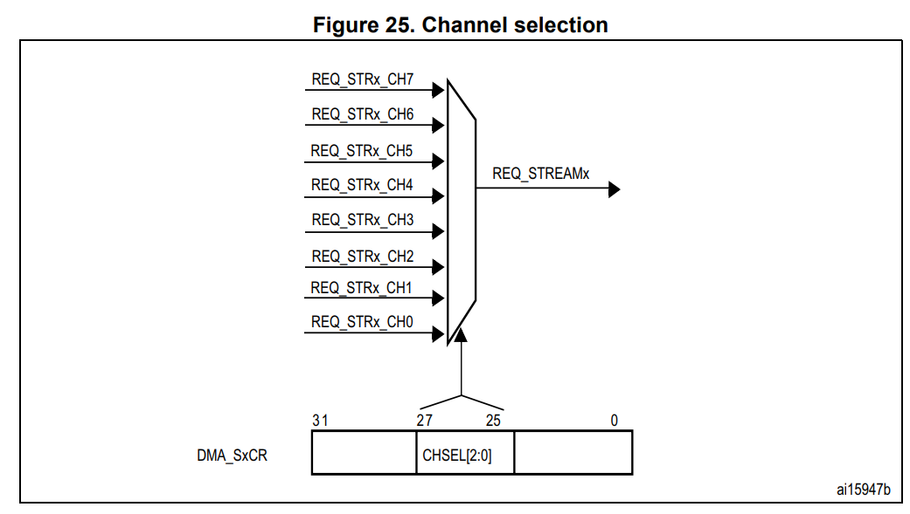

### Channel selection 〔
- 각 스트림은 **8개의 채널 요청 중에서 선택한 DMA 요청 1개**와 연결됩니다. 선택은 `DMA_SxCR`의 `CHSEL[2:0]` 비트로 합니다.
- 주변장치의 요청 8개는 각 채널에 독립적으로 연결되어 있고, 어떻게 연결되는지는 제품마다 다릅니다.  F446의 연결은 3절 매핑 표를 보세요.

> ⚠ **Caution **: 같은 주변장치 요청을 서로 다른 두 채널에 할당하는 것은, 애플리케이션이 **두 채널이 동시에 서비스 요청을 받지 않도록 보장할 때만** 허용됩니다. 두 채널이 같은 요청을 동시에 받으면 **DMA 하드웨어 동작을 예측할 수 없습니다(unpredictable).**
>
> 예를 들어 I2C1_RX는 DMA1 **Stream0 Ch1**과 **Stream5 Ch1** 양쪽에 매핑되어 있습니다 . 두 스트림을 동시에 켜 두면 안 됩니다. 〔추론〕 스트림을 바꿀 때는 기존 스트림을 끈 뒤 **EN이 0으로 읽히는 것을 확인하고**  새 스트림을 켜는 것이 안전합니다.

## 3. 요청 매핑 표

주변장치는 **(컨트롤러, Stream, Channel)** 조합으로 고정 매핑되어 있습니다. 

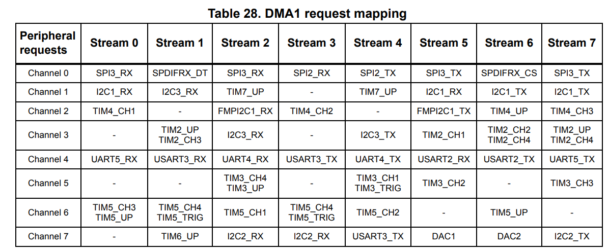

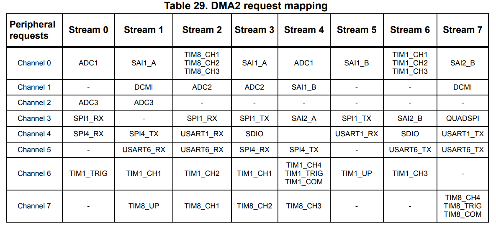

### 자주 쓰는 조합 

**DMA1**

| 주변장치 | Stream | Channel |
|---|---|---|
| USART2_RX | 5 | 4 |
| **USART2_TX** | **6** | **4** |
| USART3_RX | 1 | 4 |
| USART3_TX | 3 (또는 4, Ch7) | 4 |
| SPI2_RX / SPI2_TX | 3 / 4 | 0 |
| SPI3_RX | 0 또는 2 | 0 |
| SPI3_TX | 5 또는 7 | 0 |
| I2C1_RX | 0 또는 5 | 1 |
| I2C1_TX | 6 또는 7 | 1 |
| TIM2_UP | 1 또는 7 | 3 |
| DAC1 / DAC2 | 5 / 6 | 7 |

**DMA2**

| 주변장치 | Stream | Channel |
|---|---|---|
| **ADC1** | **0 또는 4** | **0** |
| ADC2 | 2 또는 3 | 1 |
| ADC3 | 0 또는 1 | 2 |
| SPI1_RX | 0 또는 2 | 3 |
| SPI1_TX | 3 또는 5 | 3 |
| USART1_RX | 2 또는 5 | 4 |
| USART1_TX | 7 | 4 |
| USART6_RX | 1 또는 2 | 5 |
| USART6_TX | 6 또는 7 | 5 |
| TIM1_UP | 5 | 6 |
| QUADSPI | 7 | 3 |

> 💡 **NUCLEO-F446RE**: ST-LINK 가상 COM 포트는 **USART2 (PA2 = TX, PA3 = RX)**입니다. 그래서 첫 DMA 실습은 보통 **DMA1 Stream6 Channel4 (USART2_TX)**로 합니다. 
> 기본 설정은 SB13·SB14 ON, SB62·SB63 OFF입니다. 쉴드의 D0/D1로 쓰려면 반대로 바꿔야 하고, 그러면 PC 터미널과는 연결되지 않습니다. 

## 4. DMA1과 DMA2의 차이

각 DMA에는 AHB 마스터 포트가 두 개(Memory port, Peripheral port) 있습니다.  **두 컨트롤러의 차이는 이 포트들이 어디에 연결되어 있는지에서 나옵니다.**

### 버스 매트릭스 마스터 목록 
버스 매트릭스에 연결된 DMA 마스터는 **DMA1 memory bus, DMA2 memory bus, DMA2 peripheral bus** 세 개입니다. **DMA1 peripheral bus는 목록에 없습니다.**

### 포트별 연결 (RM p.54 Figure 1의 연결점 기준)

| | Memory port | Peripheral port |
|---|---|---|
| **DMA1** | `DMA_MEM1` → 버스 매트릭스 → **Flash(DCODE), SRAM1, SRAM2, FMC/QuadSPI** | `DMA_PI` → 버스 매트릭스를 **거치지 않고 APB1에 직접** 연결 |
| **DMA2** | `DMA_MEM2` → 버스 매트릭스 → **Flash(DCODE), SRAM1, SRAM2, AHB1, AHB2, FMC/QuadSPI** | `DMA_P2` → 버스 매트릭스 → **Flash(DCODE), SRAM1, SRAM2, AHB1, AHB2, FMC/QuadSPI** **+ APB2에 직접** 연결 |


각 버스의 역할 
- **DMA memory bus**: 메모리와의 전송에 쓰입니다. 대상은 데이터 메모리(내부 Flash, SRAM1, SRAM2, FMC/QUADSPI 외부 메모리)입니다.
- **DMA peripheral bus**: **AHB 주변장치 접근**과 **메모리 간 전송**에 쓰입니다. 대상은 AHB/APB 주변장치와 데이터 메모리입니다. 버스 매트릭스에 연결된 peripheral bus는 DMA2뿐이므로 이 설명은 DMA2에 해당합니다.

### 결론
- **Memory-to-Memory는 DMA2만 가능합니다.** 〔RM p.200, p.208〕 M2M을 하려면 Peripheral port도 메모리에 접근할 수 있어야 하는데, DMA1의 Peripheral port(`DMA_PI`)는 APB1에만 연결되어 있기 때문입니다. 
- **DMA1은 APB1 주변장치 전용**입니다. Peripheral port가 APB1에만 닿기 때문에, DMA1 매핑 표에는 USART2/3, UART4/5, SPI2/3, I2C1/2/3, TIM2~7, DAC 같은 APB1 주변장치만 있습니다.
- **DMA2는 APB2 주변장치와 AHB 주변장치를 담당합니다.** 매핑 표에는 ADC, SPI1/4, USART1/6, TIM1/8, SDIO, DCMI, QUADSPI 등이 있습니다. 

## 5. 우선순위와 중재

중재기(arbiter)는 컨트롤러마다 8개 스트림의 요청을 우선순위에 따라 관리합니다. 중재는 **두 AHB 마스터 포트(Memory port, Peripheral port) 각각에 대해** 이루어집니다.

중재는 두 단계로 이루어집니다.
1. **소프트웨어 우선순위** (`PL[1:0]`): Very high > High > Medium > Low
2. 같으면 **하드웨어 우선순위**: **스트림 번호가 낮을수록 우선**합니다 (Stream 2가 Stream 4보다 우선).

- 스트림은 중재에서 이겨야 소스나 목적지 AHB 포트에 접근할 수 있습니다. 〔RM p.206–208〕
- Direct 모드에서는 FIFO 포화를 피하기 위해 우선순위를 높게 설정하라고 권장합니다. 〔RM p.216〕
- 이 중재는 **DMA 컨트롤러 내부**의 중재입니다. DMA1과 DMA2 사이, 또는 DMA와 CPU 사이의 중재는 버스 매트릭스의 라운드 로빈입니다. 〔RM p.55〕 (1부 6절 참고)

## 6. 전송 방향과 주소 레지스터

〔RM p.205–206 Table 30〕

| DIR[1:0] | 방향 | 소스 | 목적지 |
|---|---|---|---|
| 00 | Peripheral → Memory | `SxPAR` | `SxM0AR` |
| 01 | Memory → Peripheral | `SxM0AR` | `SxPAR` |
| 10 | Memory → Memory | **`SxPAR`** | **`SxM0AR`** |
| 11 | 예약 | – | – |

- 소스와 목적지는 0x0000_0000 ~ 0xFFFF_FFFF 전체 4GB 공간을 지정할 수 있습니다. 〔RM p.205〕
- PSIZE/MSIZE가 half-word이면 주소는 2바이트, word이면 4바이트 경계에 정렬되어야 합니다. 〔RM p.206〕
- **M2M에서는 Circular와 Direct 모드를 쓸 수 없습니다.** 〔RM p.208〕


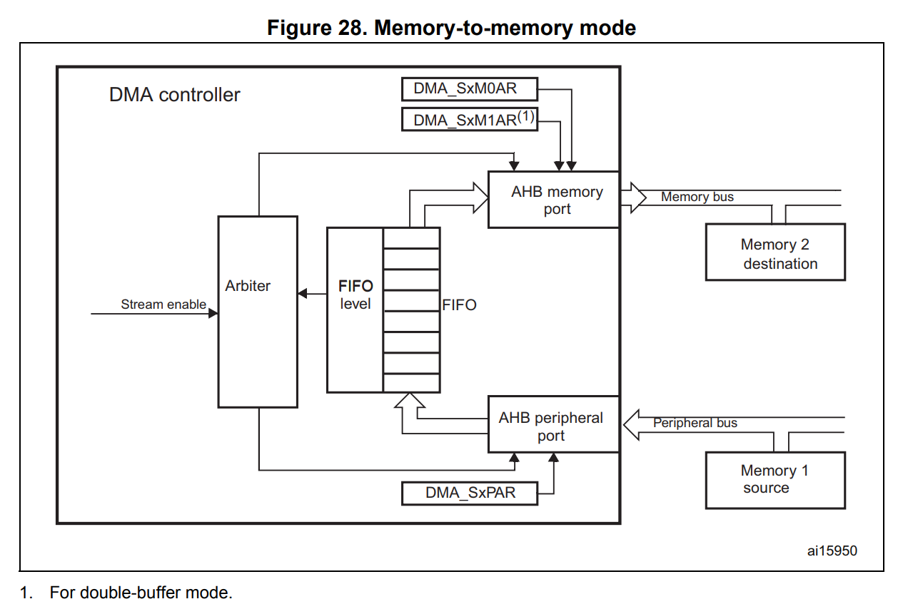

## 7. 주소 증가와 데이터 폭

### 주소 증가 
- `PINC` / `MINC`로 주변장치 / 메모리 주소를 증가시킬지 정합니다. 증가량은 폭에 따라 1, 2, 4입니다.
- **PINCOS**(bit 15): 1로 설정하면 PSIZE와 관계없이 주변장치 주소가 **항상 4씩** 증가합니다(32bit 정렬). 메모리 포트에는 영향이 없습니다.
- 주소 증가를 끄는 것은 주변장치 데이터가 **하나의 레지스터**로 들어오고 나갈 때 유용합니다.

**예 — UART 수신**: 소스(`USART->DR`)는 항상 같은 레지스터이므로 증가하지 않고(`PINC=0`), 목적지(`rx_buf[]`)는 한 칸씩 증가합니다(`MINC=1`).


### 데이터 폭과 NDTR 
- **NDTR은 PSIZE(주변장치 쪽 폭) 단위의 개수**입니다. 예를 들어 PSIZE가 half-word이면 실제 전송 바이트 수는 2 × NDT입니다.
- PSIZE와 MSIZE가 다르면 FIFO가 **패킹/언패킹**을 합니다. **리틀 엔디언만** 지원합니다.
- **Direct 모드에서는 패킹이 불가능합니다.** 폭은 PSIZE로 통일되고 MSIZE는 무시됩니다.
- 패킹 도중 전송이 끊기면 데이터가 깨질 수 있습니다. 버스트로 설정하면 묶음이 쪼개지지 않아 이를 막을 수 있습니다.

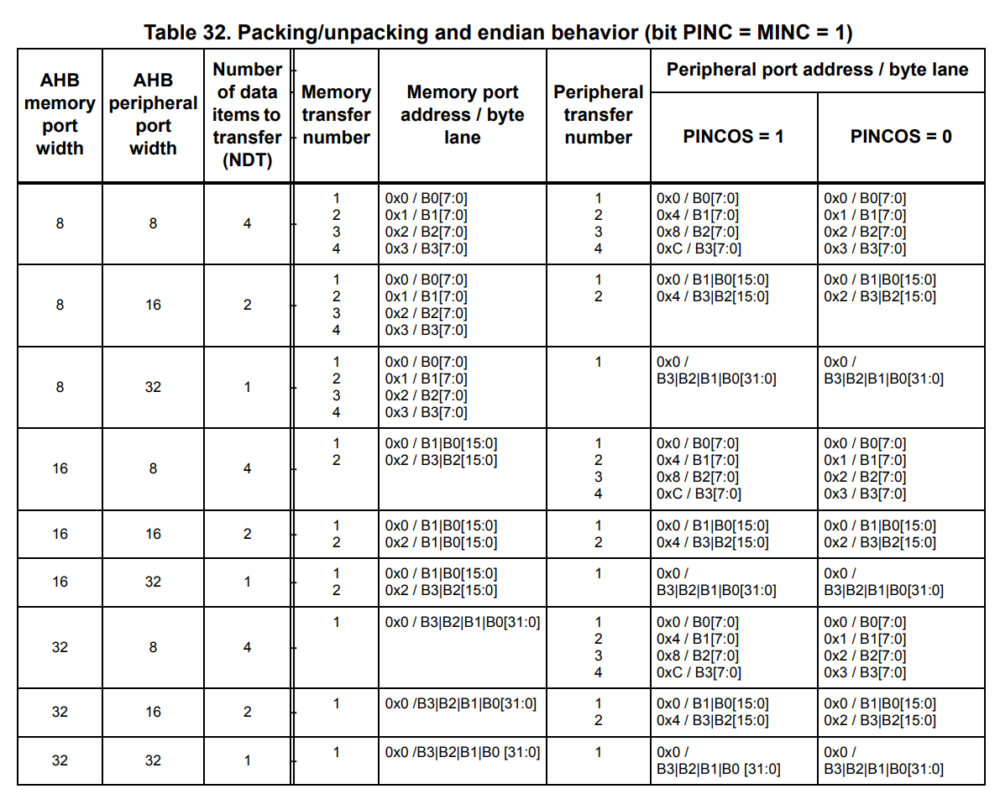

**NDT 제약** — 마지막 전송이 불완전해지는 것을 막기 위한 규칙입니다. 〔


RM p.212 Table 33〕

| PSIZE | MSIZE | NDT 조건 |
|---|---|---|
| 8bit | 16bit | 2의 배수 |
| 8bit | 32bit | 4의 배수 |
| 16bit | 32bit | 2의 배수 |

## 8. Circular 모드


- `CIRC=1`로 켭니다. NDTR이 0이 되면 초기값으로 자동 재로드되고 요청을 계속 처리합니다.
- **메모리 버스트와 함께 쓸 때는 NDTR 규칙을 지켜야 합니다.**
  ```
  NDTR = (Mburst beat) × (MSIZE / PSIZE) 의 배수
  예) INCR8, MSIZE=byte, PSIZE=half-word → 8 × 1/2 = 4의 배수
  ```
  이를 어기면 동작과 데이터 무결성이 보장되지 않습니다. NDTR은 (Pburst × PSIZE)의 배수이기도 해야 합니다.
- **주변장치 흐름 제어 모드에서는 Circular가 금지**됩니다. 

## 9. Double-buffer 모드


- `DBM=1`로 켜면 메모리 포인터 2개(`M0AR`, `M1AR`)를 사용하고, 한 번의 전송이 끝날 때마다 둘이 교체됩니다.
- **DBM=1이면 Circular가 자동으로 켜집니다** (CIRC 비트 무시).
- 따라서 **M2M과 Double-buffer는 함께 쓸 수 없습니다.** 〔RM p.211 Table 31〕
- 모든 DMA1/DMA2 스트림에서 사용할 수 있습니다.
- 현재 대상은 `CT` 비트로 알 수 있습니다. 동작 중에도 **DMA가 쓰지 않는 쪽 주소**는 바꿀 수 있습니다.

| CT | DMA가 사용 중 | 바꿀 수 있는 레지스터 |
|---|---|---|
| 0 | M0AR | **M1AR** |
| 1 | M1AR | **M0AR** |

- 잘못된 쪽에 쓰면 **TEIF가 발생하고 스트림이 자동으로 꺼집니다.** 안전하게 하려면 **TCIF가 뜬 직후** 주소를 바꿉니다.
- Double-buffer가 아닌 모드에서는 EN=1인 동안 메모리 주소 레지스터가 쓰기 보호됩니다.


## 10. FIFO와 Direct 모드

### FIFO 구조 
- 스트림마다 독립된 **4 word FIFO**가 있습니다. 임계값은 1/4, 1/2, 3/4, Full 중에서 고릅니다.
- FIFO 모드를 쓰려면 `DMA_SxFCR.DMDIS = 1`로 설정합니다. 리셋 기본값은 Direct 모드입니다.

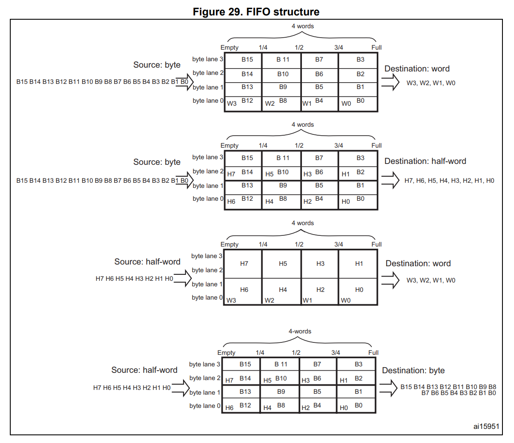

### FIFO의 역할
- FIFO는 소스에서 온 데이터를 목적지로 보내기 전에 **잠시 저장**합니다. 
- RM은 DMA를 "**독립된 FIFO**로 시스템 대역폭을 최적화하는" 구조라고 소개합니다. 
- FIFO 모드에서만 가능한 기능은 다음과 같습니다.
  1. **패킹/언패킹**: 소스와 목적지 폭이 다르면 자동으로 묶거나 나눠서 대역폭을 최적화합니다. 
  2. **버스트 전송**: Direct 모드에서는 single 전송만 가능합니다. 
- **FIFO 임계값이 메모리 쪽 접근 시점을 결정합니다.**
  - P→M: 임계값에 도달하면 FIFO를 비워 메모리에 씁니다. 
  - M→P: FIFO 레벨이 임계값 이하가 되면 메모리에서 다시 가득 채웁니다. 

### FIFO 임계값 × 메모리 버스트 허용 조합 


| MSIZE | FIFO 임계값 | INCR4 | INCR8 | INCR16 |
|---|---|---|---|---|
| Byte | 1/4 | 4beat × 1 | ❌ | ❌ |
| | 1/2 | 4beat × 2 | 8beat × 1 | ❌ |
| | 3/4 | 4beat × 3 | ❌ | ❌ |
| | Full | 4beat × 4 | 8beat × 2 | 16beat × 1 |
| Half-word | 1/4 | ❌ | ❌ | ❌ |
| | 1/2 | 4beat × 1 | ❌ | ❌ |
| | 3/4 | ❌ | ❌ | ❌ |
| | Full | 4beat × 2 | 8beat × 1 | ❌ |
| Word | 1/4, 1/2, 3/4 | ❌ | ❌ | ❌ |
| | Full | 4beat × 1 | ❌ | ❌ |

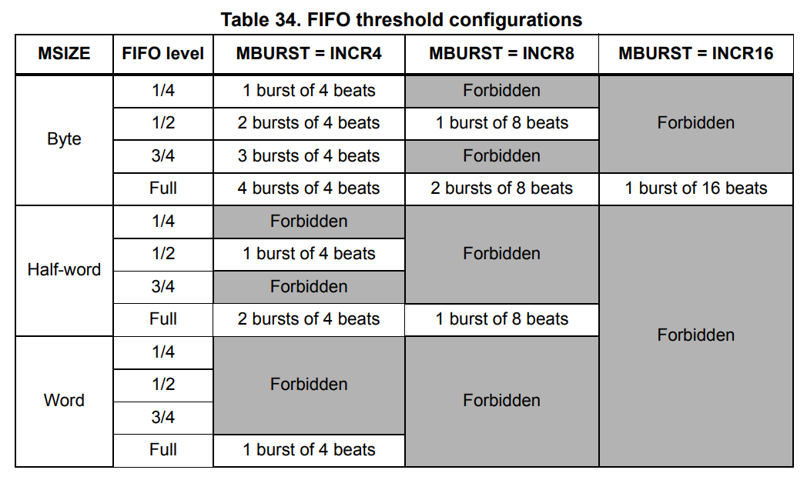

- 원칙: **임계값만큼의 데이터가 메모리 버스트의 정수배여야** 합니다. 어기면 EN 시점에 **FEIF가 발생하고 스트림이 자동으로 꺼집니다.**
- 버스트 크기 × 데이터 크기는 FIFO 크기(16바이트)를 넘을 수 없습니다.
- **PBURST × PSIZE = 4 word**이면 **임계값 3/4은 금지**입니다 (영구적인 오버런/언더런 방지).
- 전송 끝에 버스트 단위가 맞지 않고 남은 데이터는 single 전송으로 처리됩니다.

### FIFO Flush
- P2M 또는 M2M에서 EN=0으로 끄면 **FIFO에 남은 데이터를 목적지로 마저 내보낸 뒤** TCIF가 뜹니다.
- 이때 NDTR은 **실제로 목적지에 들어간 양**을 나타냅니다.
- ⚠ FIFO에 남은 바이트가 MSIZE보다 적으면(예: 2바이트 남았는데 MSIZE가 word) **MSIZE 크기로 쓰여서 원치 않는 값이 기록됩니다.** 유효한 데이터 범위는 NDTR로 판단하세요.

### Direct 모드 
- 요청이 올 때마다 FIFO를 거치지 않고 즉시 1개씩 전달합니다.
- M2P에서는 Enable 직후 **데이터 1개를 미리 읽어 둡니다(preload).** 그래서 요청이 오면 바로 내보낼 수 있습니다.
- 제약: 소스와 목적지 폭이 같아야 하고(PSIZE), **single 전송만 가능**하며, **M2M에서는 사용 금지**입니다.
- FIFO 포화를 피하려면 **우선순위를 높게** 설정하라고 권장합니다.

## 11. 버스트 전송


- `MBURST` / `PBURST`로 포트별 버스트를 따로 설정합니다: Single, INCR4, INCR8, INCR16.
- 버스트 크기는 **바이트 수가 아니라 beat 수**입니다. INCR4 + word = 16바이트입니다.
- 버스트 도중에는 **AHB 버스가 잠겨서** 버스 매트릭스가 DMA로부터 버스를 빼앗지 않습니다. 그래서 버스트 묶음은 쪼개지지 않습니다.
- Peripheral 포트가 single이면 DMA 요청 1개당 데이터 1개, 버스트이면 요청 1개당 4/8/16 beat를 전송합니다. Memory 포트도 MBURST/MSIZE에 따라 같은 방식으로 동작합니다.
- **Peripheral 쪽 버스트** 크기는 보통 **주변장치 FIFO 크기의 절반**으로 설정합니다.
- **Memory 쪽 버스트**는 FIFO 임계값과 맞아야 합니다. RM p.215 Table 34〕
- Direct 모드에서는 single 전송만 가능하고, MBURST/PBURST는 하드웨어가 강제로 정합니다.
- 버스트 안의 모든 전송은 전송 크기 경계에 정렬되어야 합니다.
- ⚠ **버스트 블록은 1KB 주소 경계를 넘으면 안 됩니다.** 넘으면 AHB 에러가 나지만 **DMA 레지스터에는 보고되지 않습니다.**

## 12. 전송 완료, 일시정지, 재개

### 전송 완료 
- Normal 모드에서는 NDTR이 0이 되면 **하드웨어가 EN을 0으로 만듭니다.** 다시 하려면 재설정 후 EN=1을 해야 합니다.
- P2M에서는 FIFO에 남은 데이터까지 메모리에 들어가야 완료로 처리됩니다.

### 중단 / 일시정지 / 재개 
**완전히 중단할 때**: EN=0만 쓰면 됩니다. 진행 중인 전송이 끝나야 실제로 꺼지고, TCIF가 뜨며 EN이 0으로 읽힙니다. NDTR에는 멈춘 시점에 **남은 개수**가 들어 있어서 몇 개를 보냈는지 알 수 있습니다.

**나중에 이어서 할 때**:
1. EN=0을 쓰고 **EN이 0으로 읽힐 때까지 대기**합니다. 이때 TCIF도 뜹니다.
2. **NDTR을 읽어** 남은 개수를 확인합니다.
3. 진행된 만큼 PAR/M0AR 주소를 조정합니다.
4. NDTR에 남은 개수를 다시 씁니다.
5. EN=1로 켜면 멈춘 지점부터 재개됩니다.

## 13. 흐름 제어 (Flow controller)


- **DMA가 흐름 제어**(`PFCTRL=0`): 소프트웨어가 스트림을 켜기 전에 NDTR에 개수를 지정합니다.
- **주변장치가 흐름 제어**(`PFCTRL=1`): 개수를 미리 모를 때 주변장치가 하드웨어로 마지막 데이터를 알려줍니다.
  - **F446에서는 SDIO만** 지원합니다.
  - NDTR에 무엇을 쓰든 스트림을 켜면 **0xFFFF로 강제**됩니다. 전송량은 `0xFFFF − NDTR`로 구합니다.
  - 끝나는 경우는 세 가지입니다: 소프트웨어가 EN=0으로 미리 중단, 주변장치가 마지막 데이터 신호를 보냄, NDTR이 0이 됨. 마지막 경우에도 이미 보낸 데이터는 잃지 않습니다. 그래서 이 모드에서도 한 번에 최대 65535개까지만 다룰 수 있습니다.
  - Circular는 금지이고, M2M에서는 PFCTRL이 강제로 0입니다.

## 14. 가능한 설정 조합

〔RM p.219 Table 35〕

| 모드 | 흐름 제어 | Circular | Direct | Double-buffer |
|---|---|---|---|---|
| P2M / M2P | DMA | 가능 | 가능 (single만, 버스트 금지) | 가능 |
| P2M / M2P | 주변장치 | **금지** | 가능 (single만) | **금지** |
| M2M | DMA만 | **금지** | **금지** | **금지** |

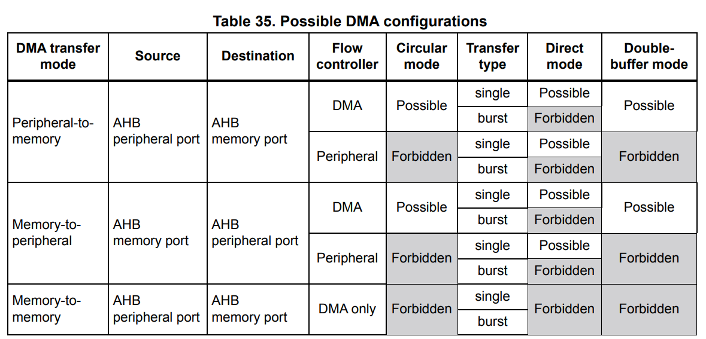

## 15. 인터럽트와 에러

### 인터럽트 

| 이벤트 | 플래그 | Enable 비트 |
|---|---|---|
| Half-transfer | HTIF | HTIE (SxCR) |
| Transfer complete | TCIF | TCIE (SxCR) |
| Transfer error | TEIF | TEIE (SxCR) |
| FIFO overrun/underrun/level error | FEIF | **FEIE (SxFCR)** |
| Direct mode error | DMEIF | DMEIE (SxCR) |

- ⚠ **Enable 비트를 켜기 전에 해당 플래그를 먼저 지워야** 합니다. 그렇지 않으면 즉시 인터럽트가 발생합니다. 
- 인터럽트 벡터는 `DMA1_Stream0_IRQn` 등 스트림별로 하나씩 있습니다. 


### 에러 상세 

| 플래그 | 발생 조건 | 스트림 자동 정지 |
|---|---|---|
| **TEIF** | 읽기/쓰기 중 버스 에러, Double-buffer에서 사용 중인 주소 레지스터에 쓰기 | **예** |
| **FEIF** (설정 오류) | FIFO 임계값과 메모리 버스트가 맞지 않는 상태에서 Enable | **예** |
| **FEIF** (오버런/언더런) | FIFO 오버런·언더런 (M2M에서는 감지 안 함) | 아니요 |
| **DMEIF** | Direct 모드 + P2M + **MINC=0**에서, 이전 데이터를 메모리에 다 쓰기 전에 새 요청이 옴 | 아니요 |

- 오버런/언더런이 나도 DMA는 주변장치에 ACK를 미룰 뿐 **DMA 쪽 데이터는 잃지 않습니다.** 다만 이 상태가 길어지면 **주변장치 자체에서 오버런이 나서 데이터를 잃을 수 있습니다.**
- Direct 모드에서도 메모리 버스를 오래 얻지 못하면 FEIF(P2M 오버런, M2P 언더런)가 발생할 수 있습니다.

## 16. 레지스터


| 레지스터 | 역할 |
|---|---|
| `DMA_LISR` / `DMA_HISR` | 인터럽트 상태 (Stream 0~3 / 4~7) | 
| `DMA_LIFCR` / `DMA_HIFCR` | 플래그 클리어 (1을 써서 클리어) | 
| `DMA_SxCR` | 스트림 설정 |
| `DMA_SxNDTR` | 전송 개수 (0~65535). 동작 중에는 남은 개수 | 
| `DMA_SxPAR` | 주변장치 주소 (M2M에서는 소스) | 
| `DMA_SxM0AR` | 메모리 주소 0 (M2M에서는 목적지) | 
| `DMA_SxM1AR` | 메모리 주소 1 (Double-buffer용) | 
| `DMA_SxFCR` | FIFO 설정 및 상태 |
| 레지스터 맵 | Table 37 | |

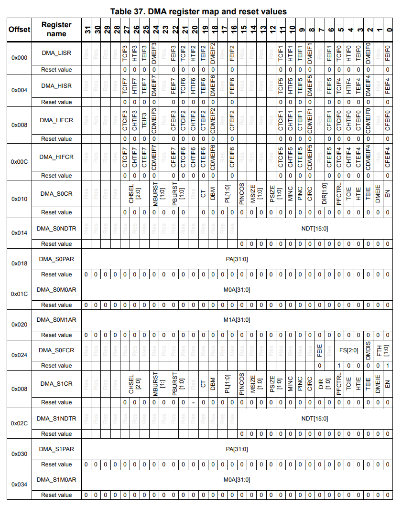 일부분 발췌..

### `DMA_SxCR` 

| 비트 | 이름 | 의미 |
|---|---|---|
| 27:25 | CHSEL | 채널 선택 (0~7) |
| 24:23 | MBURST | 메모리 버스트 (00 single, 01 INCR4, 10 INCR8, 11 INCR16) |
| 22:21 | PBURST | 주변장치 버스트 |
| 20 | – | 예약 |
| 19 | CT | Double-buffer의 현재 대상 (0 = M0AR, 1 = M1AR) |
| 18 | DBM | Double-buffer 모드 |
| 17:16 | PL | 우선순위 (00 Low ~ 11 Very high) |
| 15 | PINCOS | 주변장치 주소 증가 폭을 4로 고정 |
| 14:13 | MSIZE | 메모리 폭 (00 byte, 01 half-word, 10 word) |
| 12:11 | PSIZE | 주변장치 폭 |
| 10 | MINC | 메모리 주소 증가 |
| 9 | PINC | 주변장치 주소 증가 |
| 8 | CIRC | Circular 모드 |
| 7:6 | DIR | 방향 (00 P→M, 01 M→P, 10 M→M) |
| 5 | PFCTRL | 주변장치 흐름 제어 |
| 4 | TCIE | 전송 완료 인터럽트 |
| 3 | HTIE | 절반 전송 인터럽트 |
| 2 | TEIE | 전송 에러 인터럽트 |
| 1 | DMEIE | Direct 모드 에러 인터럽트 |
| 0 | EN | 스트림 Enable. 0으로 읽혀야 설정 가능 |

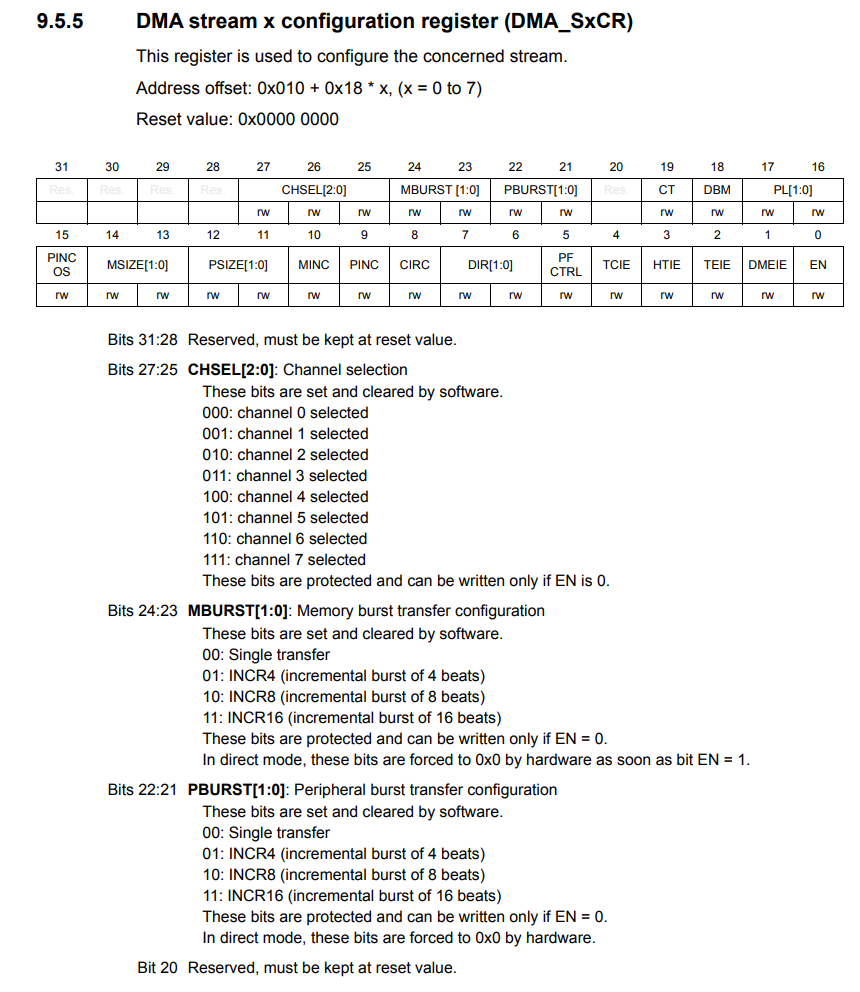 일부분 발췌..

### `DMA_SxFCR` 

| 비트 | 이름 | 의미 |
|---|---|---|
| 7 | FEIE | FIFO 에러 인터럽트 Enable |
| 5:3 | FS | FIFO 상태 (읽기 전용) |
| 2 | DMDIS | 1이면 FIFO 모드, 0이면 Direct 모드 |
| 1:0 | FTH | 임계값 (00 1/4, 01 1/2, 10 3/4, 11 Full) |

## 17. 설정 절차와 켜고 끄는 순서

### 스트림 설정 절차 
1. 스트림이 켜져 있으면 **EN=0을 쓰고, EN이 0으로 읽힐 때까지 대기**합니다. 진행 중인 전송이 끝나야 실제로 꺼집니다.
2. 이전 전송의 **상태 플래그를 모두 클리어**합니다 (LIFCR/HIFCR).
3. `SxPAR`에 주변장치 주소를 씁니다.
4. `SxM0AR`(필요하면 `SxM1AR`도)에 메모리 주소를 씁니다.
5. `SxNDTR`에 전송 개수를 씁니다.
6. `CHSEL`로 채널을 선택합니다.
7. (필요하면) `PFCTRL`을 설정합니다.
8. `PL`로 우선순위를 설정합니다.
9. `SxFCR`로 FIFO / Direct 모드를 설정합니다.
10. `SxCR`에 방향, 증가, 폭, 버스트, Circular, DBM, 인터럽트를 설정합니다.
11. **EN=1**로 스트림을 켭니다.

- 스트림이 켜지면 **바로** 연결된 주변장치의 DMA 요청을 처리할 수 있습니다. 

### 켜는 순서
1. 스트림을 설정합니다.
2. **스트림 EN=1**: M→P에서는 이때 메모리 데이터를 미리 읽어 둡니다(preload). 〔RM p.207〕
3. **그다음에** 주변장치의 DMA 요청 비트를 켭니다 (예: `USART_CR3.DMAT`).

> 이유: 메모리 버스를 얻기 **전에** 주변장치 요청이 오면 M→P에서 **언더런**이 생기고 **FEIF**가 설정될 수 있습니다. 

### 끄는 순서 ⚠ 〔RM p.220 Warning〕
1. **DMA 스트림을 먼저 끕니다** (EN=0).
2. **EN이 0이 될 때까지 대기**합니다.
3. 그다음에 주변장치를 끕니다.

### 플래그 관리
- 이전 전송에서 설정된 스트림 상태 비트(LISR/HISR)는 **스트림을 다시 켜기 전에 모두 지워야** 합니다. 
- 이벤트 플래그를 지우지 않고 Enable 비트를 켜면 **즉시 인터럽트가 발생**합니다. 
