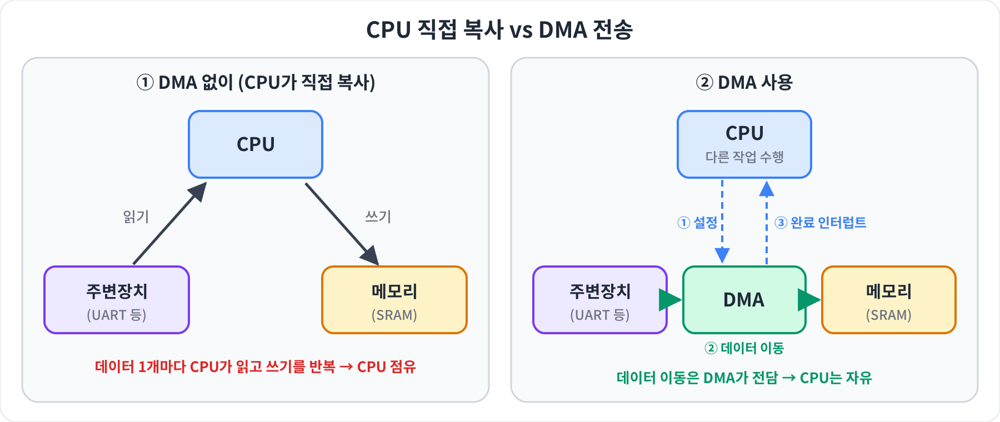
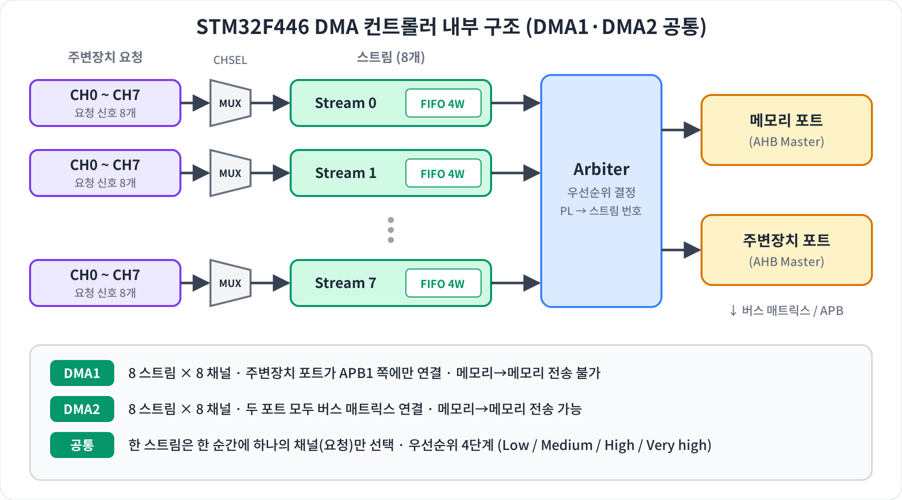
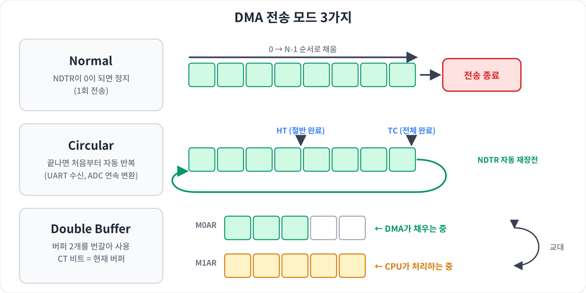
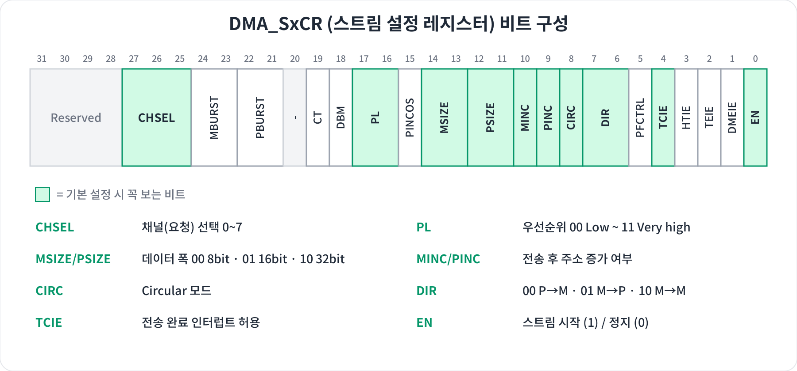
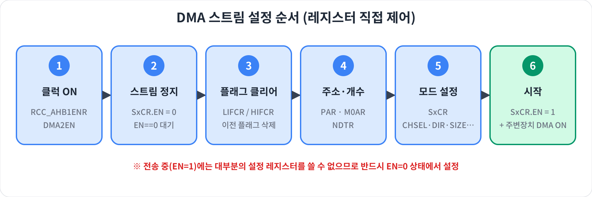

# DMA (Direct Memory Access) — STM32F446ZE

> 스터디 주제: DMA의 개념과 STM32F446ZE에서의 DMA 제어 방법
> 참고 문서: RM0390 Reference Manual (STM32F446xx), Chapter 9 "DMA controller"

---

## 1. DMA란?

DMA(Direct Memory Access)는 CPU를 거치지 않고 주변장치 ↔ 메모리, 메모리 ↔ 메모리 사이에서 데이터를 직접 옮겨 주는 하드웨어 블록입니다.

- DMA 없이: CPU가 데이터 1개마다 "읽기 → 쓰기"를 반복 → 그동안 CPU는 다른 일을 못 함
- DMA 사용: CPU는 "어디서, 어디로, 몇 개"만 설정 → 실제 이동은 DMA가 전담 → 끝나면 인터럽트로 알려 줌



### 언제 쓰나?

| 상황 | 예시 |
|---|---|
| 데이터가 많고 연속적일 때 | UART 대량 송수신, SPI 디스플레이 전송 |
| 일정 주기로 계속 들어올 때 | ADC 연속 변환 결과 저장 |
| 큰 버퍼를 복사할 때 | 메모리 → 메모리 복사 (DMA2만 가능) |

---

## 2. STM32F446의 DMA 구조

STM32F446에는 DMA1, DMA2 두 개의 컨트롤러가 있고, 각각 8개의 스트림(Stream)과 스트림마다 8개의 채널(Channel)을 가집니다.



### 핵심 용어 정리

| 용어 | 의미 |
|---|---|
| Stream | 실제로 전송을 수행하는 통로. DMA당 0~7번, 총 8개 |
| Channel | 스트림에 연결할 주변장치 요청 선택 (CHSEL 비트, 0~7) |
| Arbiter | 여러 스트림이 동시에 요청할 때 우선순위로 순서 결정 |
| FIFO | 스트림마다 4 word(16바이트) 버퍼. 데이터 폭 변환·버스트 전송에 사용 |
| NDTR | 전송할 데이터 개수 (전송될 때마다 1씩 감소) |

### DMA1 vs DMA2

| 구분 | DMA1 | DMA2 |
|---|---|---|
| 주변장치→메모리 | O | O |
| 메모리→주변장치 | O | O |
| 메모리→메모리 | X | O |
| 주로 연결되는 장치 | APB1 장치 (USART2/3, SPI2/3, I2C 등) | APB2 장치 (ADC, USART1/6, SPI1 등) |

### 어떤 Stream / Channel을 써야 할까?

주변장치마다 연결된 스트림·채널이 하드웨어로 정해져 있습니다. 반드시 RM0390의 DMA request mapping 표(Table 28 DMA1, Table 29 DMA2)를 확인해야 합니다.

| 주변장치 | DMA | Stream | Channel |
|---|---|---|---|
| USART3_RX | DMA1 | Stream 1 | 4 |
| USART3_TX | DMA1 | Stream 3 | 4 |
| USART2_RX | DMA1 | Stream 5 | 4 |
| USART2_TX | DMA1 | Stream 6 | 4 |
| ADC1 | DMA2 | Stream 0 (또는 4) | 0 |
| 메모리→메모리 | DMA2 | 아무 Stream | 무관 |

> NUCLEO-F446ZE 보드의 ST-Link 가상 COM 포트는 USART3(PD8/PD9)에 연결되어 있습니다.

---

## 3. 전송 방향과 데이터 설정

### 전송 방향 (DIR)

| DIR | 방향 | 소스 주소 | 목적지 주소 |
|---|---|---|---|
| 00 | 주변장치 → 메모리 | PAR | M0AR |
| 01 | 메모리 → 주변장치 | M0AR | PAR |
| 10 | 메모리 → 메모리 | PAR | M0AR |

### 주소 증가 (PINC / MINC)

- 주변장치 레지스터(예: `USART3->DR`)는 주소가 고정 → PINC = 0
- 메모리 버퍼(배열)는 다음 칸으로 이동해야 함 → MINC = 1

### 데이터 폭 (PSIZE / MSIZE)

`00` = 8bit(byte), `01` = 16bit(half-word), `10` = 32bit(word)
UART는 8bit, ADC(12bit 결과)는 보통 16bit를 사용합니다.

---

## 4. 전송 모드



| 모드 | 동작 | 대표 용도 |
|---|---|---|
| Normal | NDTR이 0이 되면 전송 종료. 다시 하려면 재설정 | UART로 문자열 1회 송신 |
| Circular | 끝나면 NDTR 자동 재장전, 처음부터 반복 | ADC 연속 측정, UART 상시 수신 |
| Double Buffer | M0AR / M1AR 두 버퍼를 번갈아 사용 | 오디오·대용량 스트리밍 |

### 인터럽트 플래그

| 플래그 | 의미 |
|---|---|
| HTIF (Half Transfer) | 절반 전송 완료 |
| TCIF (Transfer Complete) | 전체 전송 완료 |
| TEIF (Transfer Error) | 버스 오류 발생 |
| FEIF / DMEIF | FIFO 오류 / Direct mode 오류 |

> Circular 모드에서 HT·TC 인터럽트를 함께 쓰면 "DMA가 뒤쪽 절반을 채우는 동안 CPU는 앞쪽 절반을 처리"하는 방식으로 데이터 손실 없이 처리할 수 있습니다.

---

## 5. 핵심 레지스터

| 레지스터 | 역할 |
|---|---|
| `DMA_SxCR` | 스트림 설정 (채널, 방향, 폭, 모드, 인터럽트, 시작) |
| `DMA_SxNDTR` | 전송할 데이터 개수 |
| `DMA_SxPAR` | 주변장치 주소 |
| `DMA_SxM0AR` / `M1AR` | 메모리 주소 (M1AR은 Double Buffer용) |
| `DMA_SxFCR` | FIFO 설정 |
| `DMA_LISR` / `HISR` | 상태 플래그 (Stream 0~3 / 4~7) |
| `DMA_LIFCR` / `HIFCR` | 플래그 클리어 (1을 써서 클리어) |



---

## 6. 설정 순서



1. `RCC->AHB1ENR`에서 DMA 클럭 활성화 (DMA는 AHB1 버스)
2. `SxCR.EN = 0`으로 스트림을 끄고, 실제로 0이 될 때까지 대기
3. `LIFCR` / `HIFCR`로 이전 플래그 모두 클리어
4. `PAR`, `M0AR`, `NDTR`에 주소와 개수 설정
5. `SxCR`에 채널·방향·데이터 폭·주소 증가·모드·우선순위·인터럽트 설정 (+ 필요 시 `FCR`)
6. `SxCR.EN = 1`로 시작 → 주변장치 쪽 DMA 요청도 켜기 (예: `USART_CR3.DMAT`)

---

## 7. 예제 코드

### 예제 1 — 레지스터 직접 제어: 메모리 → 메모리 복사 (DMA2 Stream0)

```c
#include "stm32f4xx.h"

#define N 64
uint32_t src[N], dst[N];
volatile uint8_t dma_done = 0;

void DMA2_M2M_Init(void)
{
    /* 1. DMA2 클럭 ON */
    RCC->AHB1ENR |= RCC_AHB1ENR_DMA2EN;

    /* 2. 스트림 정지 후 대기 */
    DMA2_Stream0->CR &= ~DMA_SxCR_EN;
    while (DMA2_Stream0->CR & DMA_SxCR_EN);

    /* 3. Stream0 플래그 전부 클리어 */
    DMA2->LIFCR = DMA_LIFCR_CTCIF0 | DMA_LIFCR_CHTIF0 | DMA_LIFCR_CTEIF0
                | DMA_LIFCR_CDMEIF0 | DMA_LIFCR_CFEIF0;

    /* 4. 주소·개수 (M2M에서는 PAR = 소스, M0AR = 목적지) */
    DMA2_Stream0->PAR  = (uint32_t)src;
    DMA2_Stream0->M0AR = (uint32_t)dst;
    DMA2_Stream0->NDTR = N;

    /* 5. 모드 설정 */
    DMA2_Stream0->CR = DMA_SxCR_DIR_1      /* 10: Memory → Memory   */
                     | DMA_SxCR_PSIZE_1    /* 32bit                 */
                     | DMA_SxCR_MSIZE_1    /* 32bit                 */
                     | DMA_SxCR_PINC       /* 소스 주소 증가        */
                     | DMA_SxCR_MINC       /* 목적지 주소 증가      */
                     | DMA_SxCR_PL_1       /* 우선순위 High         */
                     | DMA_SxCR_TCIE;      /* 전송 완료 인터럽트    */

    /* M2M은 Direct mode 불가 → FIFO 사용 */
    DMA2_Stream0->FCR = DMA_SxFCR_DMDIS | DMA_SxFCR_FTH;   /* FIFO full */

    NVIC_EnableIRQ(DMA2_Stream0_IRQn);
}

void DMA2_M2M_Start(void)
{
    dma_done = 0;
    DMA2_Stream0->CR |= DMA_SxCR_EN;   /* 6. 시작 */
}

void DMA2_Stream0_IRQHandler(void)
{
    if (DMA2->LISR & DMA_LISR_TCIF0) {
        DMA2->LIFCR = DMA_LIFCR_CTCIF0;  /* 플래그 클리어 필수 */
        dma_done = 1;
    }
}
```

### 예제 2 — HAL 사용: UART DMA 송수신 (NUCLEO-F446ZE, USART3)

CubeMX 설정:
`Connectivity > USART3 > DMA Settings > Add` 에서 `USART3_TX`(DMA1 Stream3), `USART3_RX`(DMA1 Stream1) 추가.
RX는 Mode를 Circular로 설정하면 계속 수신 가능.

```c
uint8_t tx_msg[] = "Hello DMA!\r\n";
uint8_t rx_buf[16];

int main(void)
{
    HAL_Init();
    SystemClock_Config();
    MX_GPIO_Init();
    MX_DMA_Init();          /* 반드시 USART Init보다 먼저 호출 */
    MX_USART3_UART_Init();

    HAL_UART_Transmit_DMA(&huart3, tx_msg, sizeof(tx_msg) - 1);
    HAL_UART_Receive_DMA(&huart3, rx_buf, sizeof(rx_buf));

    while (1) {
        /* CPU는 다른 작업 가능 */
    }
}

/* 전송 완료 콜백 */
void HAL_UART_TxCpltCallback(UART_HandleTypeDef *huart)
{
    if (huart->Instance == USART3) { /* 송신 완료 처리 */ }
}

/* 수신 완료 콜백 (rx_buf가 가득 찼을 때) */
void HAL_UART_RxCpltCallback(UART_HandleTypeDef *huart)
{
    if (huart->Instance == USART3) { /* rx_buf 처리 */ }
}
```

---

## 8. 자주 하는 실수

| 실수 | 해결 |
|---|---|
| 스트림이 켜진 상태(EN=1)에서 설정 변경 | EN=0 확인 후 설정 |
| 이전 플래그를 안 지우고 재시작 | `LIFCR`/`HIFCR`로 먼저 클리어 |
| 인터럽트 핸들러에서 플래그 미클리어 | 핸들러가 무한 반복 호출됨 → 반드시 클리어 |
| 잘못된 Stream/Channel 조합 | RM0390 request mapping 표 확인 |
| DMA1으로 메모리→메모리 시도 | M2M은 DMA2만 가능 |
| CubeMX에서 `MX_DMA_Init()`이 UART Init 뒤에 생성됨 | 호출 순서를 DMA 먼저로 수정 |
| 주변장치 쪽 DMA 요청 비트를 안 켬 | 예: `USART_CR3.DMAT/DMAR`, `ADC_CR2.DMA` |

---

## 9. 한 줄 요약

> DMA는 "CPU 대신 데이터를 옮겨 주는 일꾼"이다.
> STM32F446에서는 DMA(1/2) → Stream(0~7) → Channel(0~7)을 고르고, 주소·개수·방향·폭·모드를 설정한 뒤 EN을 켜면 된다.

---

## Reference

- [RM0390 Reference Manual — STM32F446xx](https://www.st.com/resource/en/reference_manual/rm0390-stm32f446xx-advanced-armbased-32bit-mcus-stmicroelectronics.pdf) (Chapter 9 DMA controller)
- [AN4031 — Using the STM32F2/F4/F7 DMA controller](https://www.st.com/resource/en/application_note/an4031-using-the-stm32f2-stm32f4-and-stm32f7-series-dma-controller-stmicroelectronics.pdf)
- [UM1974 — STM32 Nucleo-144 boards User Manual](https://www.st.com/resource/en/user_manual/um1974-stm32-nucleo144-boards-mb1137-stmicroelectronics.pdf)
