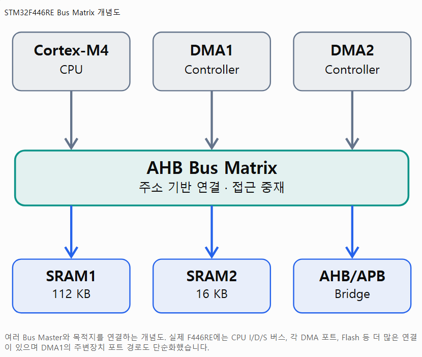
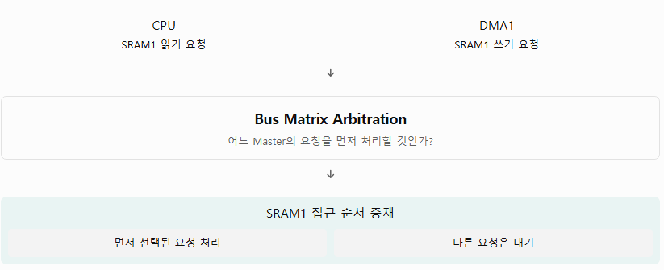
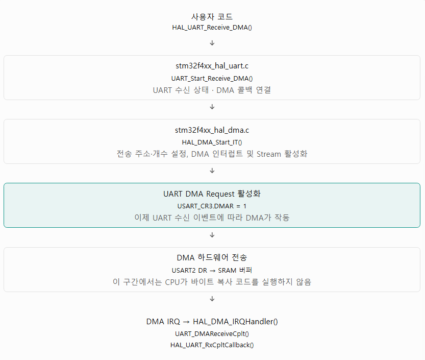

# DMA가 뭐지

1. DMA의 개념: CPU 대신 별도의 하드웨어가 데이터를 전송하는 원리

2. DMA의 내부 구조: DMA Controller, Stream, Channel, Bus, 전공 요청(Request)의 관계

3. DMA의 제어 방법: STM32CubeMX/HAL을 통한 설정과 실제 레지스터 수준에서의 제어

## DMA의 개념과 동작 원리

### DMA가 필요한 이유

UART로 1,000바이트 수신한다고 가정

**DMA를 사용하지 않는 경우**

```
UART에서 데이터 수신
       │
       ▼
CPU가 UART 수신 레지스터 확인
       │
       ▼
CPU가 데이터 읽기
       │
       ▼
CPU가 SRAM에 데이터 저장
       │
       ▼
다음 바이트에 대해 반복
```

CPU가 Polling 또는 Interrupt 방식으로 데이터 전송 과정에 계속 관여해야 합니다.

**DMA를 사용하는 경우**

```
UART에서 데이터 수신
       │
       ▼
DMA Controller에 전송 요청
       │
       ▼
DMA가 UART 데이터 레지스터 읽기
       │
       ▼
DMA가 SRAM에 데이터 저장
       │
       ▼
지정한 개수만큼 자동 반복
       │
       ▼
전송 완료 시 CPU에 알림 (선택)
```

### DMA 가 어떻게 CPU없이 메모리에 접근할까?

DMA Controller가 Bus Master로 동작할 수 있기 때문에

STM32F446RE의 Cortex-M4 CPU와 DMA Controller는 Bus Matrix를 통해 메모리와 주변장치에 접근한다.

CPU가 LDR, STR 명령어로 메모리를 읽고 쓰는 것처럼, DMA 컨트롤러도 AHB 트랜잭션을 발생시켜 데이터에 접근할 수 있음

그렇다고 DMA가 CPU와 완전히 독립적인 메모리를 사용하는 건 아님. 같은 버스나 메모리를 동시에 사용하려고 할 경우 버스 중재가 발생하며, DMA 전송이 CPU 메모리 접근 지연에 영향을 줄 수 있음. (완전 독립 메모리가 아니라서 이런 문제가 있을 수는 있다는 거임)

-> 그게 뭔 개소린데??

즉 CPU와 DMA가 각각 독립적으로 메모리에 읽기/쓰기 요청을 보낼 수 있고 Bus Matrix는 그 요청을 실제 메로리나 주변장치에 연결해 주는 하드웨어 라는 의미

이걸 이해하려면 CPU가 메모리에 어떻게 접근하는지 알아야함

<details>
<summary> 상세내용 </summary>
다음과 같은 코드를 생각해보자

```
uint8_t buffer[10];

buffer[0] = 0x41;
```

CPU는 buffer[0]에 0x41을 저장해야 함.

근데 SRAM은 CPU 내부에 있는 게 아닌, MCU 안에 존재하는 별도의 메모리 하드웨어임

따라서 CPU는 SRAM에 데이터를 저장해달라는 요청을 보내야 함

이런 요청에는 다음과 같은 정보가 포함 됨

| 신호 정보  | 의미                     | 예시       |
| ---------- | ------------------------ | ---------- |
| Address    | 어디에 접근 할 것인가?   | 0x20000000 |
| Write/Read | 읽기인가 쓰기인가?       | Write      |
| Write Data | 무슨 값을 기록할 것인가? | 0x41       |
| Control    | 전송 종류 등             | Byte 접근  |

CPU가 이런 정보를 전달하고 SRAM이 요청을 처리하면 해당 주소에 값이 기록 됨.

이렇게 주소, 데이터, 제어 정보를 전달하는 하드웨어 연결 체계가 **BUS**임

근데 CPU와 DMA가 둘 다 메모리에 접근하려면??

STM32F446RE에는 CPU 이외에도 DMA1, DMA2 등 메모리에 접근해야 하는 하드웨가 존재함

그래서 MCU 내부에는 여러 하드웨어가 목적지에 접근하도록 연결하고 중재하는 Bus Matrix가 존재함



여기서 두 용어를 알아야 함

**Bus Master** 읽기/쓰기 요청을 시작하는 하드웨어를 의미함 (CPU와 DMA Controller...)

**Bus Slave** 그 요청을 받아서 처리하는 하드웨어. (SRAM 주변장치의 레지스터 인터페이스 등...)

UART 수신을 예로 들면

USART2가 문자 'A'(0x41)을 수신했다고 가정

DMA 설정은 다음과 같음

```
DMA1_Stream5->PAR   = (uint32_t)&USART2->DR;
DMA1_Stream5->M0AR  = (uint32_t)rx_buffer;
DMA1_Stream5->NDTR  = 16;
```

USART2의 데이터 레지스터 주소는 0x40004404

반면 rx_buffer가 예를 들어 0x20000000 에 위치한다고 가정하면, 실제 하드웨어에서는 다음 과정이 일어남

1. **USART2가 DMA Request 발생**<br>수신 데이터가 준비되면 USART2의 RXNE 상태가 설정 USART_CR3.DMAR가 활성화 돼 있으면 USART2가 DMA1에 요청 신호를 보냄.<br>이 Request는 데이터를 전달하는 버스 트랜잭션 자체가 아니라, DMA에게 전송을 수행하도록 알리는 별도의 하드웨어 신호임

2. **DMA가 USART2 데이터 레지스터를 읽음**<br>
   DMA의 Peripheral 측 포트가 USART2 레지스터 주소에 대한 읽기 트랜잭션을 발생시킴.<br>USART2는 APB1 주변 장치이므로 AHB/APB Bridge를 거쳐 해당 레지스터 접근<br>DMA는 읽어온 0x41을 내부 전선 경로에 받음

3. **DMA가 SRAM에 쓰기 요청 발생**<br>
   이번에는 DMA의 Memory측 포트가 0x20000000을 대상으로 쓰기 트랜잭션을 시작함.<br>
   Bus Matrix는 주소를 보고 해당 요청을 SRAM1 인터페이스에 연결. SRAM값을 기록하면 전송 완료

4. **DMA가 다음 전송 준비**<br>
   MINC=1이므로 다음 SRAM 기록 위치를 1바이트 증가 시키고 NDTR은 16에서 15로 감소

**그럼 CPU와 DMA가 같은 SRAM에 동시 접근하면??**

다음과 같은 상황이 발생하면



같은 SRAM 자원에 대한 접근이 충돌하면 Bus Matrix가 중재해야 함

Bus Matrix의 Master 간 중재에는 Round-robin 방식이 사용 됨

따라서 DMA가 데이터를 옮겨도 CPU의 메모리 접근이 언제나 아무 지연없이 실행 되는 것은 아님.

반면 CPU가 Flash에서 명령어를 읽고 DMA가 SRAM1에 접근하는 경우처럼 **서로 다른 자원**을 대상으로 하면 병렬처리가 가능

</details>

### DMA와 Interrupt 차이

DMA와 Interrupt는 서로 대체하는 기술이 아님

| 구분             | Interrupt                      | DMA                            |
| ---------------- | ------------------------------ | ------------------------------ |
| 데이터 이동      | CPU가 ISR 수행                 | DMA 하드웨어가 수행            |
| CPU 개입         | 각 데이터 또는 이벤트마다 가능 | 주로 설정, 완료, 오류 처리     |
| 데이터 처리 단위 | 소프트웨어에 따라 결정         | 사전에 설정한 블록 단위        |
| 장점             | 간단한 이벤트 처리, 유연성     | 대량·연속 전송의 CPU 부담 감소 |
| 단점             | 높은 이벤트 빈도에서 ISR 부담  | 설정 및 버퍼 관리 복잡성       |

실제로 DMA도 Half Transfer, Transfer Complete, Error 등의 이벤트에서 Interrupt를 사용할 수 있음

## STM32F446RE의 DMA 하드웨어 구조

STM32F446RE에는 두 개의 범용 DMA 컨트롤러가 존재함

각 Stream은 최대 8개의 Channel 요청 중 하나를 선택할 수 있음

중요한 것은 **Channel이 8개의 독립적인 데이터 전송 통로라는 의미가 아니라, Stream에 연결할 주변장치 요청을 선택하는 번호**라는 점

### DMA Controller, Stream, Channel

- Controller: DMA1또는 DMA2. 여러 Stream의 버스 접근을 중재함
- Stream: 실제 전송을 수행하는 단위. 주소, 데이터 크기, 전송 개수, 우선순위 등을 설정
- Channel: 특정 Stream이 어떤 주변장치의 DMA 요청을 받을지 선택하는 역할

### DMA 전송 방향

| 모드                 | 의미              | 활용사례                   |
| -------------------- | ----------------- | -------------------------- |
| Peripheral to Memory | 주변장치 → 메모리 | UART 수신, ADC 수집        |
| Memory to Peripheral | 메모리 → 주변장치 | UART 송신, DAC 출력        |
| Memory to Memory     | 메모리 → 메모리   | 배열 또는 데이터 블록 복사 |

**STM32F446RE에서 범용 DMA의 Memory-to-Memory 기능은 DMA2에서만 지원된다는 제약**

### 주요 DMA 동작 모드

**Normal Mode**는 정해진 개수의 데이터를 옮기고 전송을 종료

**Circular Mode**는 정해진 개수를 전송한 후 다시 버퍼 시작위치부터 전송함. 연송 ADC 샘플링 또는 UART 수신에 많이 사용

**또한 STM32F446RE DMA는 FIFO, Double Buffer, Half Transfer/Transfer Complete Interrupt 등의 기능을 지원. 이러한 기능은 데이터 스트림 처리에서 특히 유용**

## DMA의 본질: CPU 대신 Bus Master가 되는 하드웨어

DMA는 단순히 데이터를 자동복사하는 것이 아님

**DMA Controller가 CPU와 별개로 메모리 버스에 접근할 수 있는 Bus Master라는 것**이 핵심

## HAL_UART_Receive_DMA()의 전체 호출 흐름


